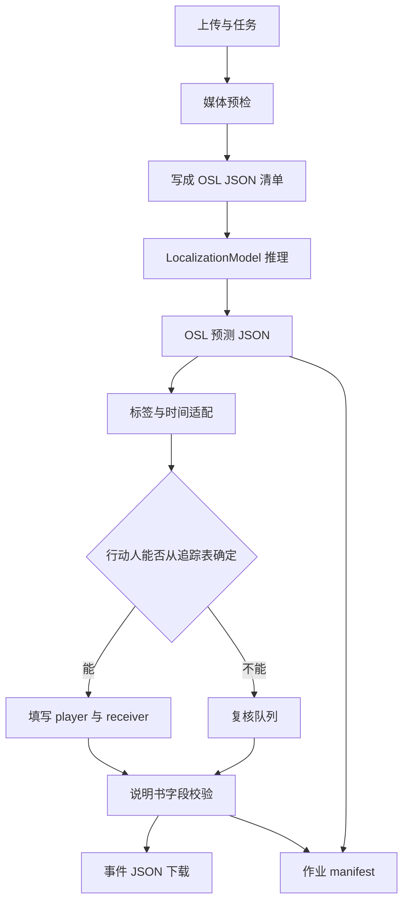

# 足球赛事视频事件 JSON 系统概要设计

**文档类型：** 概要设计  
**版本：** 2.0  
**依据：** [OpenSportsLib](https://github.com/OpenSportsLab/opensportslib)（文档站 [opensportslab.github.io/opensportslib](https://opensportslab.github.io/opensportslib/)）  
**术语：** OSL = OpenSportsLib  
**交付物：** 符合 `事件说明书.md` 的事件 JSON  
**内部交换格式：** OSL JSON 2.0

本版以 OSL 为视频理解运行时。库负责可训练、可推理、可评测的动作定位；项目自己负责上传、时间轴、标签适配、人员关系、说明书 JSON 和复核。

## 1. OSL 是什么

OSL 是 OpenSportsLib 的简称，OpenSportsLab 发布的 Python 库。它用一份 YAML 配置描述任务、数据和模型，然后完成训练、推理或评测。训练样本、推理清单和模型预测使用同一种文件，称为 OSL JSON，当前版本是 2.0。

对一段足球视频，OSL 的定位任务回答两件事：动作发生在视频的哪一毫秒，这一时刻属于哪个类别。结果写在 `events` 里，例如：

```json
{"head": "action", "label": "pass", "position_ms": 17400}
```

`label` 是类别名，`position_ms` 是该视频上的毫秒时刻。预测还可以带 `confidence`。OSL 不填写说明书要求的 `player_id`、`receiver_id`、`player_code`、`player_screen_xy` 和中文动作名。

因此本系统把 OSL 放在中间层：客户视频先写成 OSL JSON 清单，交给定位入口得到动作点，再由项目适配器换成 `事件说明书.md` 规定的事件数组。OSL 预测是内部结果，不直接提供下载。

库不附带比赛视频和标注。视频、项目标注和 OSL 清单由本系统准备。已发布权重只作为定位起点，其分数不作为对客户的交付承诺。

## 2. 库的边界

当前可运行的任务只有三个：

| 任务 | 公开入口 | 本系统中的角色 |
|---|---|---|
| 动作定位 / spotting | `LocalizationModel` | 主链路。从整段或区间视频给出带 `position_ms` 的动作点 |
| 动作分类 | `ClassificationModel` | 只用于已经切好的短片段。不用于从整场视频里找事件 |
| 视觉问答 VQA | `VQAModel` | 可选的复核辅助。问答文本不写入事件 JSON |

检索和字幕/caption 在官方路线图中，当前没有任务封装、数据集分发或模型路由。不进入本系统。

一次标准调用是：

```text
规范 YAML
  -> ClassificationModel | LocalizationModel | VQAModel
  -> 数据集与模型构建
  -> train / infer / evaluate
  -> 内存中的 OSL JSON 预测
  -> save_predictions(...) 显式落盘
```

`infer()` 不写文件。预测里的分数字段是 `confidence`。它留在 OSL 预测和作业元数据里，不写入说明书事件对象。

库不附带可直接训练的演示数据。客户视频、项目标注和 OSL JSON 清单都由本系统提供。已发布权重只作为起点，其类别和分数不能当成交付 SLA。

## 3. 两条 JSON

系统内部和对外交付使用两种 JSON，不互相替代。

### 3.1 内部：OSL JSON 2.0

训练、推理和库内评测都使用这一份。最小定位样本：

```json
{
  "version": "2.0",
  "task": "action_spotting",
  "labels": {
    "action": {
      "type": "single_label",
      "labels": ["pass", "drive", "shot"]
    }
  },
  "data": [
    {
      "id": "match_01",
      "inputs": [
        {"type": "video", "path": "videos/match_01.mp4", "fps": 25.0}
      ],
      "metadata": {
        "annotation_status": "verified",
        "intervals": [
          {"period": "first_half", "start_time_ms": 0, "end_time_ms": 2700000}
        ]
      },
      "events": [
        {"head": "action", "label": "pass", "position_ms": 17400}
      ]
    }
  ]
}
```

约定：

- 事件时间以 `position_ms` 为准，单位是物理视频上的绝对毫秒。
- `labels.action.labels` 是该次训练或推理允许的类别。样本标签必须落在这张表里。
- `inputs[].path` 相对 `DATA.common.splits.<split>.source_path`。
- `metadata.intervals` 用半开区间 `[start_time_ms, end_time_ms)` 标出可分析段。`verified` 参与推理和评测，`unlabeled` 只推理，`excluded` 两者都跳过。区间外事件、重叠区间会被库拒绝。
- 带区间的视频读取目前要求 OpenCV 后端。选 DALI 会报错，不能静默读错帧。
- 清单里的 `fps` 只是声明。OpenCV 加载器读取容器真实帧率，忽略该字段。
- 预测事件可以带 `frame`、`gameTime`、`confidence`。这些字段服务回溯，不进入说明书记录。

### 3.2 对外：说明书事件数组

最终下载文件仍是 `事件说明书.md` 规定的对象数组：按 `frame` 升序，字段顺序固定，人员靠 `player_id` / `receiver_id`，无法证实时写 `unknown`。

OpenSportsLib 的定位预测只有动作类别和时间点。它不产生 `player_id`、`receiver_id`、`player_code`、`player_screen_xy`，也不产生队名前缀。因此：

- 定位模型的输出先落成 OSL 预测，再由项目适配器生成说明书记录。
- 除角球外，说明书要求行动人 `player_id` 必填。身份未解析的记录停在复核队列，不进入正式下载文件。
- 适配器不得为了补齐字段而猜测球衣号、跟踪号或接球人。

## 4. 总体架构



| 子系统 | 归属 | 输入 | 输出 |
|---|---|---|---|
| 上传、预检、任务状态 | 自建 | 客户视频、赛事元数据 | 任务 ID、文件哈希、真实帧率、PTS 映射 |
| OSL 清单写入 | 自建 | 预检结果、半场区间 | 一条比赛对应一个 OSL sample |
| 动作定位 | OpenSportsLib | 规范 YAML、权重、OSL 清单 | OSL 预测，`events[].position_ms` |
| 标签与时间适配 | 自建 | OSL 预测、时间映射表 | 内部事件：类别、`frame`、画面时间、置信度 |
| 人员关联 | 自建；仅当已有追踪表 | 事件时刻、追踪行 | `player_id`、`receiver_id`、画面坐标；否则保持待复核 |
| 说明书校验与复核 | 自建 | 内部事件 | 通过校验的事件数组，或退回复核 |
| 训练与回归 | OpenSportsLib `train` / `evaluate` | 按比赛划分的 OSL 标注 | 检查点、库指标；再经适配器计算项目 P/R |
| 推理服务 | OpenSportsLib inference server，或同进程 worker | 已注册模型、视频路径或清单 | 异步 `job_id`，结果仍是 OSL 预测 |

分类模型和 VQA 不放在这条主链上。短片段分类只在离线实验里核对切段标签。VQA 只在复核台对单个争议片段提问，答案不回写 `name_cn`。

## 5. 首期模型

首期只接定位任务，并固定一个已发布权重作为基线。

| 权重 | 用途 | 类别 | 官方报告 | 本系统用法 |
|---|---|---|---|---|
| `OpenSportsLab/OSL-loc-snbas-2025-e2e` | 首期候选检测 | PASS、DRIVE、HEADER、HIGH PASS、OUT、CROSS、THROW IN、SHOT、BALL PLAYER BLOCK、PLAYER SUCCESSFUL TACKLE、FREE KICK、GOAL | tight mAP 47.98，loose mAP 58.35 | 唯一默认定位模型。DALI + GPU。先在项目验证集上重测，再决定能否减少人工 |
| `OpenSportsLab/OSL-loc-snbas-2023-e2e` | PASS / DRIVE 对照 | PASS、DRIVE | tight mAP 71.48，loose mAP 85.62 | 不作为全事件模型。只在同样两类上对比 2025 权重是否退步 |
| 项目自训检查点 | 说明书类别正式覆盖后的生产权重 | 第 6 节中的项目标签 | 无 | 用 `LocalizationModel.train` 从项目 OSL 标注训练，经 `weights` 加载 |

以下模型不进入事件 JSON 主链路：

- `OSL-cls-action-mvitv2`：犯规短片段分类，模型卡准确率 0.57。它不在整场视频上打时间点。
- 三个 `OSL-VQA-XFOUL-*`：犯规/裁判风格问答。可选复核插件。
- `skeleton-header-max-recall`：无权重的规则算法，读球员关节和球的 HDF5，仓库需申请权限。客户只上传转播视频时没有这项输入。
- `OSL-loc-tennis-public`：网球挥拍，与足球事件无关。

官方模型卡分数是库作者报告值，文档构建时不复核。接入时记录 Hugging Face 仓库 ID 和解析后的 commit，不跟踪浮动的 `main`。

### 5.1 运行配置

定位配置从安装包复制出来，放在本仓库，不直接改 site-packages 里的模板。首期视频配置保持库的 E2E 结构：`TASK: localization`、`VERSION: 2`，视频编码器接 GRU 头，再接 NMS 后处理。2025 权重的加载方式：

```python
from opensportslib.apis import LocalizationModel

model = LocalizationModel(
    config="configs/localization/broadcast_spotting.yaml",
    weights="OpenSportsLab/OSL-loc-snbas-2025-e2e",
)
predictions = model.infer(test_set="work/match_01/manifest.json")
model.save_predictions("work/match_01/predictions.json", predictions)
```

环境与库的安装约束一致：

- Python 3.12+，独立环境。`opensportslib setup` 会替换当前环境里的 PyTorch。
- 2025 视频权重走 DALI，执行 `opensportslib setup --dali`。DALI 不是 CPU 加载器；无 GPU 时库会在支持的路径上回退 OpenCV，但已发布 E2E 配置以 DALI 为准，CPU 回退要单独验证后再用于交付。
- `opensportslib setup --pyg` 会换成另一套 PyTorch 以安装图网络。追踪实验和视频推理分开环境，不装在同一个 worker 里。
- VQA 的 `--vqa_xvars` 与 `--vqa_qwen` 同样替换依赖，只在独立的复核环境中安装一种。

追踪对照实验使用库内 `configs/localization/tracking_action_spotting.yaml`：输入是整场 `tracking_parquet`，编码器是 `graph_conv_seq`，头仍是 GRU。该路径要求先有球员和球的坐标表。它用来比较“像素”和“坐标”两种输入，不作为只有视频时的必经步骤。

## 6. 标签适配

定位头输出英文类别。适配器把它变成说明书里的 `name_cn`。队名来自赛事元数据；模型分不出主客队时，`name_cn` 不能带 `Team A` 或 `Team B`，记录进入复核。

| 定位类别 | 说明书动作 | 适配规则 |
|---|---|---|
| PASS | 传球 | 只确定出球动作。`receiver_*` 在关联完成前不填具体人 |
| DRIVE | 停球（带球） | 作为持球候选。确认是同一次触球的延续时才落成停球，避免把带球过程写成多条 |
| HIGH PASS | 长传 | 先作候选。高度和距离不符合长传定义时改判或退回 |
| THROW IN | 界外手抛球 | 直接对应 |
| SHOT | 射门 | 只写射门人。射门人不单独从进球时间点反推 |
| GOAL | `Team AGoal` / `Team BGoal` | 必须已有队伍。同一时刻的射门另成一条，两条的 `player_id` 相同 |
| PLAYER SUCCESSFUL TACKLE | 抢断 | 只覆盖成功抢下。抢球人与被抢人未同时确定时不自动交付 |
| HEADER | 不单列 | 说明书没有“头球”动作名。作为内部属性，保留原事件类别 |
| CROSS | 不单列 | 归入传球或长传候选，由规则和复核决定，不新增动作名 |
| OUT | 不单列 | 只作为出界上下文，不生成说明书记录 |
| FREE KICK | 不单列 | 任意球不是角球。不映射成 `角球` |
| BALL PLAYER BLOCK | 不单列 | 说明书无对应动作 |

说明书中的角球、扑救、助攻没有对应的已发布定位类别。它们留在项目标签表中，首期只通过人工标注进入训练集；在自训模型达到门槛前，这三类不宣称自动检出。

SN-GAR 公开 spotting 数据把同一毫秒上的多个标签收成一个，高空球和射门会被大量丢掉。那是数据集的单标签约定，不是本系统的标注规则。项目标注允许同一帧多条记录，训练清单按 `事件说明书.md` 保留同时发生的射门、进球和助攻，不用 SN-GAR 的去重优先级覆盖项目定义。

## 7. 处理流程

### 7.1 预检并写出 OSL 清单

- 用容器元数据读取编码、时长、时间基和 PTS。标称帧率只作参考。
- 一条任务写成一个 OSL sample。`id` 使用任务内稳定的比赛 ID。
- 半场、中场广告和未标注片段写入 `metadata.intervals`。没有区间时，库按整段视频处理。
- 清单与视频一起进入工作目录。`source_path` 指向该目录，视频路径用相对路径。

### 7.2 定位推理

- worker 只调用 `LocalizationModel`。配置、权重版本和清单哈希写入 manifest。
- 长视频由库的滑窗和 NMS 后处理产生候选，项目不再自行切一套重叠窗口后把结果当成分段分类。
- 推理失败、区间非法或模型未就绪时，任务失败并保留错误码。不把空事件列表当成“本场无事件”。

### 7.3 时间适配

内部时间用 `position_ms`。说明书字段在适配器里一次性换算，并固定舍入：

```text
frame = round(position_ms / 1000 × 25)
action_screen_time_period = frame / 25，格式化为 MM:SS.cc
```

这一换算只用于项目约定的 25 帧/秒交付。模型评估仍在毫秒和库的秒级容差上做，不把 `frame / fps` 再喂回定位器。

可变帧率或起点不为 0 的视频，先用 PTS 得到 `position_ms`，再套上面的公式。分析帧到源帧的对应表保存在 manifest。旧样例按 30 帧/秒书写的，不与新批次混在同一文件；迁移需单独重算 `frame` 和 `action_screen_time_period`。

若将来走追踪 parquet，行号和时钟分开保存。库在该路径上用 `frame` 切窗口，用由 `position_ms` 得到的 `eval_frame` 做评测。适配器沿用这个区分，不用行号除以帧率冒充视频时间。

### 7.4 人员关联

定位预测没有行动人。关联只在下面条件同时成立时自动填写：

- 该比赛已有与视频时钟对齐的追踪表；
- 事件 `position_ms` 能落到一条追踪行，偏差不超过约定的对齐容差；
- 该行能确定触球人，并且跟踪号在本场内唯一。

自动填写时：

- 传球、长传：出球人写入 `player_*`，下一脚已确定的触球人写入 `receiver_*`。接球人自己的画面坐标写在他作为行动人的下一条上。
- 停球：只写当前行动人，`receiver_*` 为 `unknown`。
- 抢断：抢下球的人是 `player_*`，被抢的人是 `receiver_*`。
- 射门与进球：两条使用同一个 `player_id`。助攻与进球可以同帧分两条。扑救的 `receiver_id` 等于射门人的 `player_id`。

OpenSportsLib 追踪图把每帧排成 23 个槽（球、主队 11 人、客队 11 人，按球衣号排序）。槽位是模型特征，不是说明书里的 `player_id`。没有追踪表时，人员字段保持未解析并进入复核。角球在人员都未知时可以按说明书写 `unknown` 和 `[0.0, 0.0]`。

画面坐标来自该时刻行动人的检测或追踪点，轴为 x 向右、y 向下。没有坐标时，非角球记录不交付。

### 7.5 校验与交付

导出前检查 JSON 语法、字段顺序、动作名、帧序、`MM:SS.cc`、跟踪号关系和 `unknown` 规则。未通过则不提供下载。

同一任务另存 manifest：源文件哈希、OSL 清单、配置路径、权重 ID、`opensportslib` 版本、区间、时间映射、复核记录和交付文件哈希。manifest 不放进事件数组。

## 8. 训练与验收

数据按整场比赛划分训练、验证和测试，避免同一场的相邻片段泄漏。标注直接写成 OSL JSON，再由同一套适配规则生成说明书记录，保证两套文件来自同一次标注。

```python
checkpoint = model.train(train_set="data/train.json", valid_set="data/valid.json")
predictions = model.infer(test_set="data/test.json", weights=checkpoint)
library_metrics = model.evaluate(test_set="data/test.json", predictions=predictions)
```

报告分两层：

| 层级 | 指标 | 用途 |
|---|---|---|
| 库内 | 定位 mAP。容差按秒计，随本次 `extract_fps` 换算 | 判断权重和配置有没有退步。官方 tight / loose 数字只作对照 |
| 交付 | 适配并复核后的逐类 Precision、Recall、时间误差 | 判断客户拿到的 JSON。人工改过的结果不记成模型分数 |

交付层以事件类别做一对一匹配。稀疏事件的初始时间容差为 ±1 秒，传球、停球、长传、抢断为 ±0.5 秒。容差用 `position_ms` 计算。正式门槛由业务确认后写入验收，不把官方 mAP 写成 SLA。

类别样本不足、或该类别仍全量人工复核时，报告里写明模型原始分数、复核比例和最终交付分数，不宣称该类已自动覆盖。

回归在每次更换库版本、权重、类别表、NMS 窗口或时间换算后运行。追踪实验若使用 SN-GAR 发布集，先跑库文档中的核对脚本，确认评测程序在完美预测上能得到应有的 mAP 上限，再比较视频与追踪两条配置。

## 9. 服务方式

首期是异步批处理。Web 服务不在请求线程里加载模型。

GPU 推理使用 OpenSportsLib 自带的推理服务：FastAPI、Redis、RQ worker。该服务不随 `pip install opensportslib` 安装，按官方 `server` 工程单独部署。

- 模型注册到服务端，状态成为 `ready` 后才接受预测。
- 客户端用 `LocalizationModel(remote=..., remote_model_id=...)` 提交。服务端持有配置和权重，调用方不把权重路径传到浏览器。
- 整场任务使用清单加视频的 `full_test_set` 提交。一个作业失败不影响其他比赛。
- 管理接口使用 `OSL_API_KEY`。Hugging Face 令牌只放在 worker 环境，不进入仓库和日志。
- 作业超时、会话过期和模型未就绪返回明确状态。空结果与失败结果区分存放。

产品 API 只暴露任务创建、进度、复核和 JSON 下载。它调用推理服务，不把 OpenSportsLib 的配置项直接做成客户参数。

## 10. 许可与版本

OpenSportsLib 同时提供 AGPL-3.0 和商业许可。网络服务中使用并修改该库前，先确定走哪一种；以仓库中的许可证文件为准。模型权重、SN-GAR / SoccerNet 数据的使用条件单独确认，公开权重不等于训练数据和客户视频都可以再分发。

生产环境固定：

- `opensportslib` 的发行版本或 commit；
- 复制进本仓库的 YAML；
- Hugging Face 权重仓库和 commit；
- 推理服务镜像和 `OSL_MODEL_ROOT` 中的模型 ID。

## 11. 实施顺序

1. **跑通一条视频。** 安装独立环境，用 2025 定位权重对一条项目视频写出 OSL 预测，再适配成带时间、但人员待复核的内部事件。
2. **对齐说明书。** 用 `test_data/test.json` 反写一份 OSL 标注，核对 `position_ms`、25 帧换算和动作名映射。角球、扑救、助攻标为项目类别，不塞进 2025 权重的 12 类里。
3. **复核台。** 低置信度、无队伍、无 `player_id`、关系校验失败的记录进入人工队列。只有通过队列的记录能下载。
4. **项目训练集。** 按比赛划分标注。需要自动覆盖角球、扑救、助攻或稳定的接球关系时，训练自己的定位检查点，并用第 8 节的两层指标验收。
5. **追踪关联。** 仅在比赛已有对齐的追踪表时打开自动 `player_id`。没有追踪表的比赛保持人工身份。

每一步的退出条件是：该步承诺的字段可以复现，未承诺的字段保持未填或待复核。不用官方 mAP 代替说明书记录的逐类验收。

## 12. 风险

| 风险 | 处理 |
|---|---|
| 2025 权重的 12 类不等于说明书动作 | 用第 6 节映射；对不上的类别不发明 `name_cn` |
| 定位结果没有人 | 无追踪表则人工补身份；槽位序号不作 `player_id` |
| 清单 `fps` 与容器帧率不一致 | 时间以 PTS 和 `position_ms` 为准，交付帧按第 7.3 节换算 |
| 半场区间使用 DALI | 有区间的清单强制 OpenCV；整场无区间推理才用已发布 DALI 配置 |
| 把 SN-GAR 单标签去重当成项目标注 | 项目保留同帧多条；SN-GAR 只作公开对照集 |
| 依赖安装互相覆盖 PyTorch | 视频、追踪、VQA 分环境 |
| AGPL 与商业交付冲突 | 接入前选定许可证，不把未确认的权重和数据放进客户产物 |
| 官方 mAP 被写成客户 SLA | 交付验收用适配后的逐类 P/R 和时间误差 |

## 13. 待确认

1. 首期自动输出是否接受“时间与类别先出、身份人工补齐”，还是没有 `player_id` 的比赛整份不交付。
2. 25 帧/秒是交付格式，还是也要求客户上传必须为恒定 25 帧/秒。
3. 角球、扑救、助攻是否列入首期自动检测；若不列入，它们只出现在人工标注中。
4. 现有 30 帧/秒样例 JSON 是否重算后与新结果放在一起。
5. 推理服务是否单独部署，以及每场视频的时长上限和完成时限。

## 参考

- [OpenSportsLib 仓库](https://github.com/OpenSportsLab/opensportslib)
- [文档首页与当前可运行任务](https://opensportslab.github.io/opensportslib/)
- [OSL JSON 2.0](https://opensportslab.github.io/opensportslib/data/osl-json-format/)
- [架构与三个任务入口](https://opensportslab.github.io/opensportslib/developer/architecture/)
- [配置、训练、推理与评测](https://opensportslab.github.io/opensportslib/tni/tni/)
- [模型列表](https://opensportslab.github.io/opensportslib/model-zoo/)
- [安装与依赖配置](https://opensportslab.github.io/opensportslib/getting-started/installation/)
- [视频与追踪定位](https://opensportslab.github.io/opensportslib/spotting/tracking-action-spotting/)
- [推理服务](https://opensportslab.github.io/opensportslib/server/inference-server/)
- 项目字段规则：`事件说明书.md`
